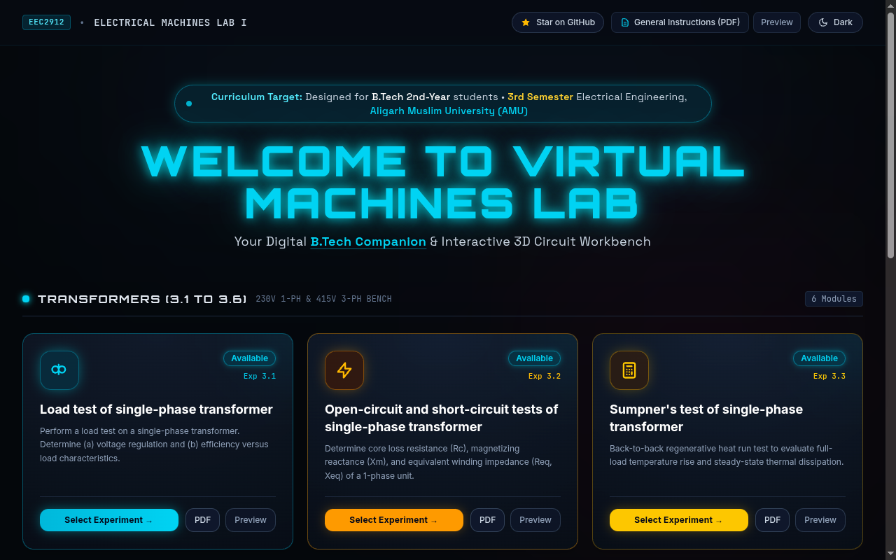
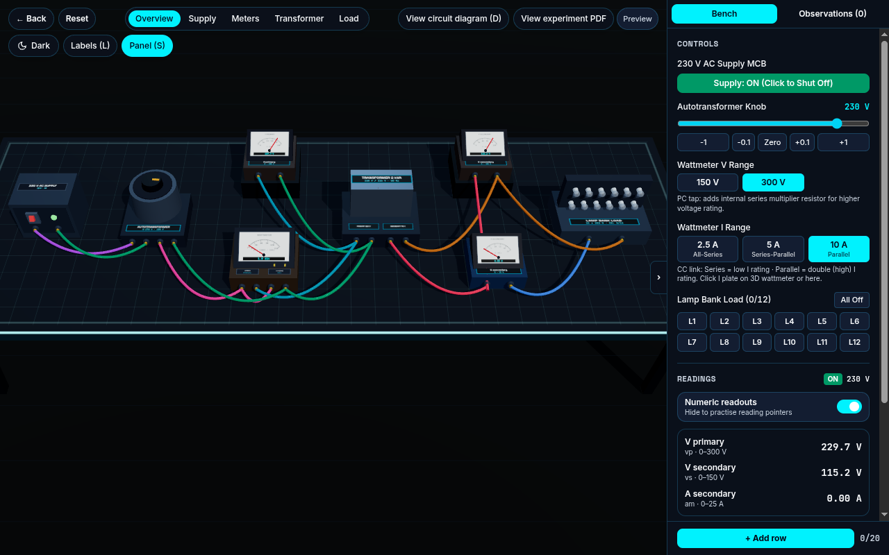
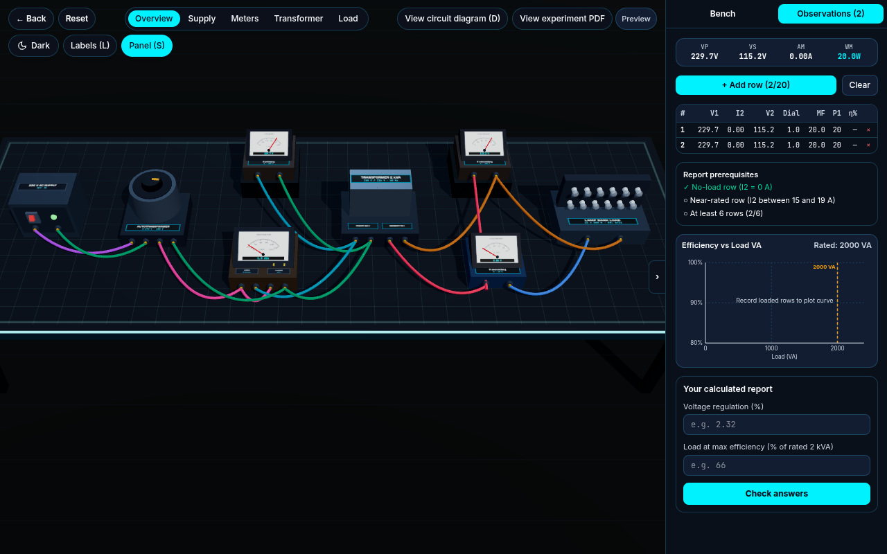
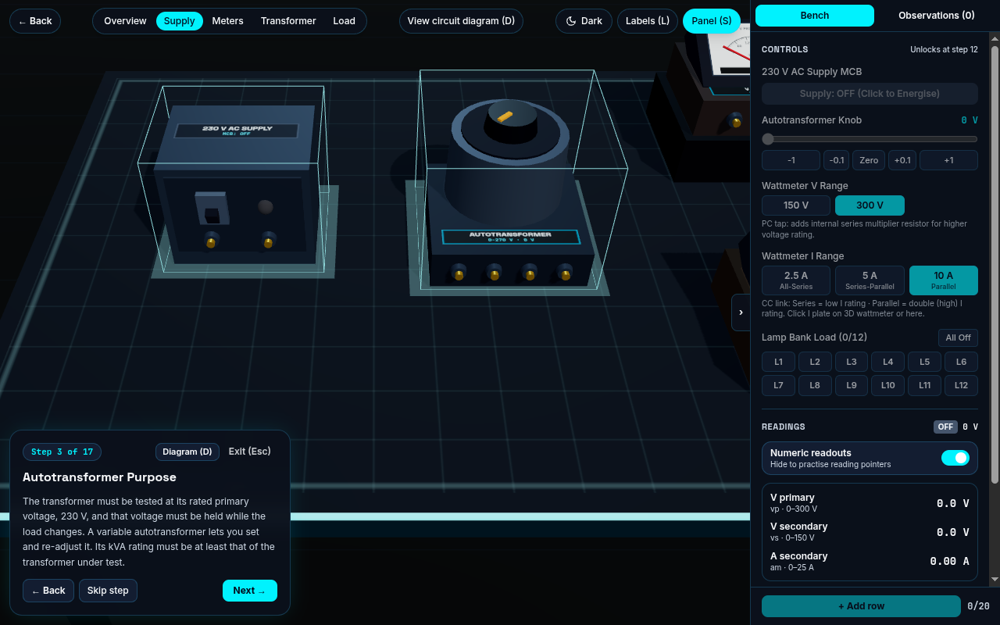

> THIS APP IS MADE FOR ZHCET, AMU 2ND YR BTECH ELECTRICAL ENG STUDENT, THIS COURSE/LAB IS PART OF 2ND YR, 3RD SEM.

# Virtual Machines Lab

Virtual Machines Lab is a 3D browser-based virtual lab for the Electrical Machines Lab 1 course (`EEC2910` / `EEC2912`). Students wire electrical circuits on an interactive bench, operate meters and supplies under physics simulation, capture readings, and calculate results on both desktop and mobile viewports.

## Live Demo

`[add URL]`

## Screenshots

| Experiment Picker | 3D Bench with Wiring |
| --- | --- |
|  |  |

| Observations Sidebar | Learn Mode |
| --- | --- |
|  |  |

## Features

- **Learn mode**: Step-by-step guided walkthrough across stages that connects wires incrementally, explains why components and leads belong where they do, and checks operating-point targets.
- **Self mode**: Unwired 3D bench per stage where students connect terminals, submit for validation, carry consistent wiring into later stages, record observations, and submit report answers.
- **Observe mode**: Pre-wired bench with stage tabs, highlighted circuit nets, and full observation and chart capture for measurement and calculation practice.
- **Terminal-click wiring and fault feedback**: Click terminals in any order to place wires; net validation catches open paths, shorts, reversed wattmeter coils, ammeters across sources, and voltmeters in series.
- **Physics-driven meters**: Live readings come from each stage's physics model with seeded class 0.5 relative meter error (`±0.5%`), needle pegging at `105%`, overload damage above `150%`, and MCB trips on faults.
- **Observations, charts, and answer checking**: Capture read-only table rows with auto-derived columns, evaluate row rules and stage prerequisites, view interactive SVG charts, and check numerical or choice answers without revealing true values.
- **Progressive hints and solution view**: Reveal stage hints step by step or load the canonical wiring for inspection.
- **Circuit diagrams and manual PDFs**: View per-experiment circuit diagrams (`public/experiments/<folder>/diagrams/`), experiment PDFs, and general lab safety instructions inside the app.
- **Dark and light themes**: Switchable theme persisted in browser `localStorage` (`vml-theme`).

## Experiments

Status below reflects [`EXPERIMENT_SUMMARIES`](src/core/experiments/registry.ts) and the definitions registered in `src/core/experiments/`:

| ID | Title | Learn | Self | Observe |
| --- | --- | --- | --- | --- |
| `ex3.1` | Load test of single-phase transformer | Available | Available | Available |
| `ex3.2` | Open-circuit and short-circuit tests of single-phase transformer | Available | Available | Available |
| `ex3.3` | Sumpner's test of single-phase transformer | Available | Available | Available |
| `ex3.4` | Parallel operation of single-phase transformers | Available | Available | Available |
| `ex3.5` | Study of various three-phase transformer connections | Available | Available | Available |
| `ex3.6` | Phase-transformation | Available | Available | Available |
| `ex4.1` | Load test of three-phase induction motor | Available | Available | Available |
| `ex4.2` | No-load and blocked-rotor tests of three-phase induction motor | Available | Available | Available |
| `ex4.5` | No-load and blocked-rotor test of single-phase capacitor-start induction motor | Coming soon | Coming soon | Coming soon |

## Getting Started

Prerequisites: Node.js (`v24.22.0` verified; no `engines` field in `package.json`) and npm (`11.19.1` verified).

```bash
npm install                                      # Install dependencies
npm run dev                                      # Start Vite dev server (runs predev asset generation)
npm run build                                    # Type-check and build dist/ (runs prebuild asset generation)
npm run preview                                  # Preview the built dist/ bundle locally
npm test                                         # Run the full Vitest test suite once
npx vitest run src/tests/core-purity.test.mjs    # Verify src/core stays free of React, three, and Zustand imports
```

Both `predev` and `prebuild` run `npm run assets:generate` (`node scripts/generate-assets.mjs`), which scans `public/experiments/` and updates [src/generated/assets.json](src/generated/assets.json). You can also run `npm run test:watch` for watch-mode testing.

## Project Structure

```text
src/
  core/           # Pure TypeScript: circuit net validation, faults, physics models, reports, and experiment data
  components3d/   # Procedural Three.js / React Three Fiber apparatus meshes, dials, terminals, and wires
  scenes/         # 3D bench scene and camera preset transitions (BenchScene.tsx)
  stores/         # Zustand state stores (session, wiring, controls, mode actions)
  ui/             # React UI panels, observations table, SVG charts, PDF/diagram viewers, Learn player
  theme/          # Light and dark theme token definitions
  tests/          # Vitest unit, integration, fairness, layout, schema, and purity tests
public/experiments/  # Course PDFs and circuit diagram PNGs served statically
scripts/             # Build-time manifest generator (generate-assets.mjs)
docs/                # Architecture spec, authoring checklist, queue rules, review notes, screenshots
```

**Layering rule**: `src/core` contains pure TypeScript with zero imports from `react`, `react-dom`, `three`, `@react-three/*`, or `zustand` (enforced by [src/tests/core-purity.test.mjs](src/tests/core-purity.test.mjs)). Stores, 3D components, and React UI sit on top of `src/core`.

## How Experiments Work

Each experiment is declared as pure data in `src/core/experiments/` (`components`, per-stage `acceptedNetlists`, `faultPatterns`, `controls`, `physicsModel`, `physicsParams`, `observationTable`, `rowRules`, `prerequisites`, `charts`, `learnSteps`, and `answers`). Terminals use `componentId.terminalName` IDs, and nets group connected terminals:

```ts
// Example terminal IDs and nets from Exp 3.1 (src/core/experiments/ex3_1.ts)
['sup.P', 'va.IN_P']
['va.OUT_P', 'wm.M', 'wm.V1']
```

Validation runs Union-Find over each component's static or control-dependent internal links plus the student's placed wires to form connected nets, so wire order and draw direction do not matter. Matched faults and open paths feed directly into the physics model so meters peg, reverse, read zero, or trip the MCB. See [docs/ARCHITECTURE.md](docs/ARCHITECTURE.md) and [docs/EXPERIMENT_AUTHORING.md](docs/EXPERIMENT_AUTHORING.md) for details.

## Adding an Experiment and Assets

Follow [docs/EXPERIMENT_AUTHORING.md](docs/EXPERIMENT_AUTHORING.md):

1. Branch from `develop` (`git checkout -b exp-<id> develop`) and review the corresponding experiment PDF and `src/generated/assets.json`.
2. Reuse existing apparatus primitives (`src/core/components.ts`, `src/components3d/`) and shared fault factories (`src/core/circuit/faultFactories.ts`) where possible.
3. Add or extend a `PhysicsModel` under `src/core/physics/models/` and register it in `src/core/physics/registry.ts` if existing models do not cover the circuit.
4. Create `src/core/experiments/exX_Y.ts` defining components, stages, `acceptedNetlists`, `observationTable`, `prerequisites`, `answers`, `charts`, and `learnSteps`.
5. Register the experiment in `RAW_EXPERIMENTS` and mark `available: true` in `EXPERIMENT_SUMMARIES` inside [src/core/experiments/registry.ts](src/core/experiments/registry.ts).
6. Register the procedure in [src/tests/helpers/referenceRun.ts](src/tests/helpers/referenceRun.ts), add unit and fairness tests under `src/tests/`, and verify `npm run build` and `npm test`.

**Adding diagrams and PDFs**: Follow [public/experiments/README.md](public/experiments/README.md). Place files under hyphenated folders (`public/experiments/ex3-1/ex-3-1.pdf`, `public/experiments/ex3-1/diagrams/fig-3-1-1.png`, and `public/experiments/common/general-instructions.pdf`), keeping PDFs under 5 MB and images under 3 MB; `npm run assets:generate` (and `predev`/`prebuild`) updates `src/generated/assets.json` automatically.

## Physics and Accuracy

Machine ratings, impedances, and losses are stored as representative placeholder values in each experiment's params object until calibrated against specific laboratory nameplate data. Simulated meter readings follow textbook equivalent-circuit and machine equations with seeded class 0.5 gain errors, so values resemble a physical bench without matching any individual machine identically. Treat this application as a study and pre-lab rehearsal tool, not a substitute for supervised lab work or the safety rules in [general-instructions.pdf](public/experiments/common/general-instructions.pdf).

## Deployment

Run `npm run build` to emit the static production site into `dist/`. [vite.config.ts](vite.config.ts) does not configure `base` (so Vite defaults to `/`). To host under a subpath (such as `/<repo-name>/`), set `base: '/<subpath>/'` in `vite.config.ts` or pass `--base=/<subpath>/` when running Vite build (`npx vite build --base=/<subpath>/`).

## Testing

```bash
npm test
```

The Vitest suite verifies net-based wiring validation and fault pattern matching, physics checkpoints and meter overload/trip behavior, report answer checking and `referenceRun` fairness across random seeds and extreme `±0.5%` meter gain combinations, Learn/Observe data integrity, schema and terminal IDs, 3D component layout spacing (`>= 0.35`), asset generation, theme tokens, and the `src/core` import boundary.

## Contributing and Credits

- **Contributing**: Open an issue describing reproduction steps or propose changes on a branch off `develop`, checking [docs/ARCHITECTURE.md](docs/ARCHITECTURE.md) and [docs/EXPERIMENT_AUTHORING.md](docs/EXPERIMENT_AUTHORING.md).
- **Credits**: Based on the course lab manual *Electrical Machine Lab 1* (`EEC2910` / `EEC2912`, see [EEC2910 - Lab Manual.pdf](docs/EEC2910%20-%20Lab%20Manual.pdf)), Zakir Husain College of Engineering and Technology (ZHCET), Aligarh Muslim University (AMU).
- **License**: `[license to be decided]`

## Course Manual Assets Notice

The PDFs and circuit figures in `public/experiments/` (and `docs/EEC2910 - Lab Manual.pdf`) come from the course lab manual. Check redistribution permissions before making the repository or deployed site public.

MADE BY ASAD MOKARIM, (https://github.com/AsadMokarim)
